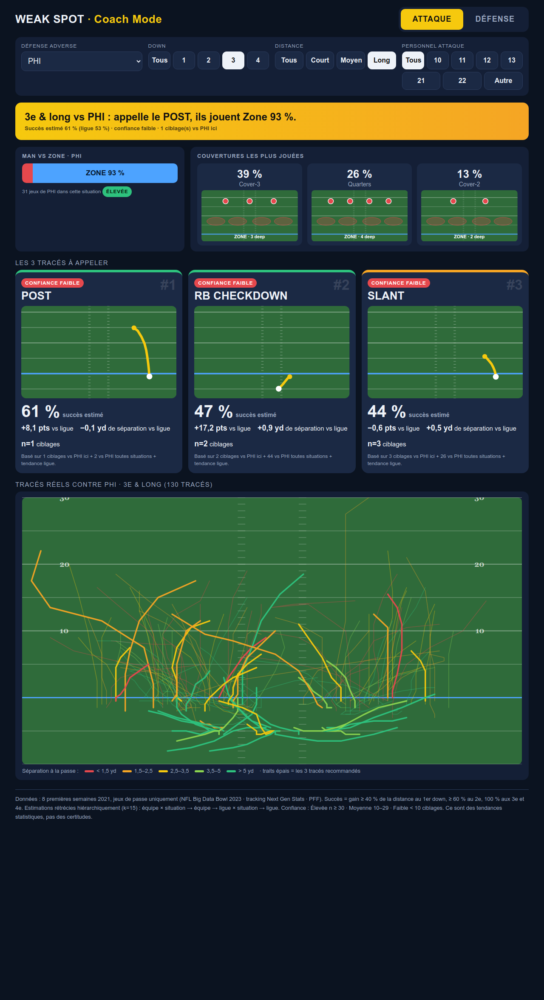
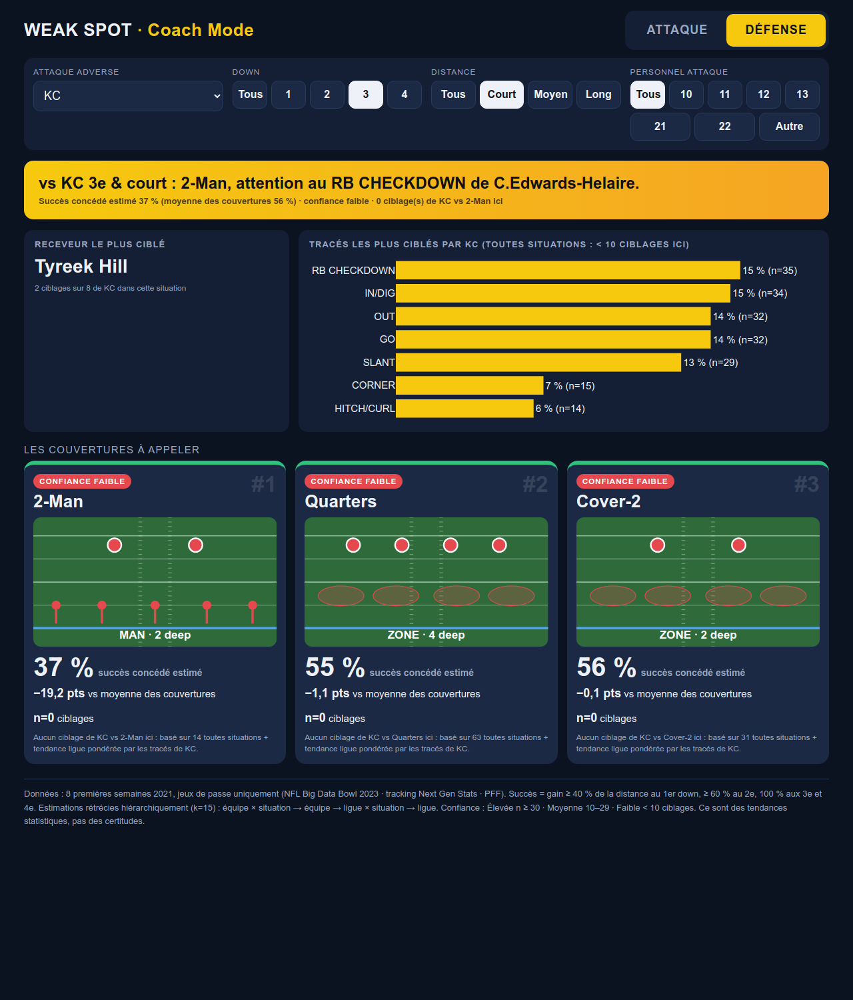

# Weak Spot

> ### Down. Distance. Personnel. Trois choix, un appel.

**Point Faible transforme les données de tracking de votre adversaire en votre prochain appel de jeu.**

Réglez le moment du match (down, distance, personnel), et Point Faible vous donne la réponse des deux côtés du ballon :

- **Mode attaque** : il affiche instantanément les tracés contre lesquels sa défense laisse le plus d'espace.
- **Mode défense** : il vous donne la couverture qui neutralise le mieux les tracés favoris de son attaque dans cette situation précise.

L'outil fonctionne des deux côtés du ballon parce qu'il étudie une seule chose : **comment cet adversaire précis se comporte dans cette situation précise**, à partir de chaque tracé couru dans les données de tracking Next Gen Stats.

> **Exemple** : sur 3e & long, PHI joue en zone sur 93 % des jeux (n=31). Toutes situations confondues, contre HOU, le GO laisse 3,7 yd de séparation contre 2,8 yd pour la ligue (n=175 tracés), pour 58 % de complétion (ligue : 44 %).

---

## Vidéo

[**Regarder la présentation video**](videos/weak_spot_30s.mp4)

## Aperçu

| Mode attaque : 3e & long vs PHI | Mode défense : 3e & court vs KC |
|---|---|
|  |  |

## Lancer l'outil

```bash
pip install -r requirements.txt && ./run_all.sh
```
