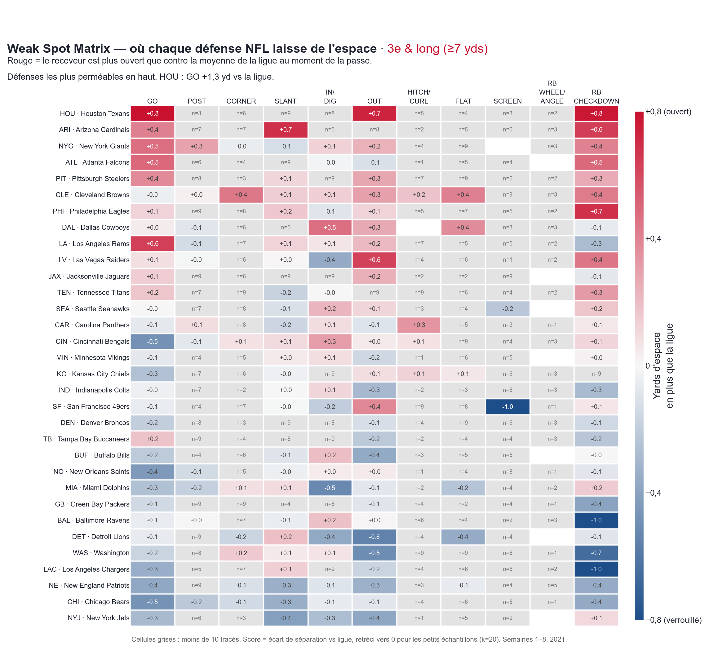

# Weak Spot : quels tracés courir contre chaque défense NFL ?

À partir du tracking Next Gen Stats (semaines 1 à 8 de 2021), nous classons automatiquement 35 032 tracés de WR, TE et RB en 11 familles (GO, POST, SLANT, OUT, etc.) et mesurons pour chacun la **séparation au moment où le ballon part**, c'est-à-dire la distance au défenseur le plus proche. Comparée à la moyenne de la ligue, elle révèle le point faible de chaque défense : contre **Houston, le GO laisse 3,7 yd d'espace contre 2,8 yd pour la ligue**, et ce gain se retrouve sur le terrain avec **58 % de complétion (ligue : 44 %) et 16,1 yards par cible (ligue : 12,1)**. Sur l'ensemble des tracés, Atlanta est la défense la plus perméable et New Orleans la plus hermétique. Face à la man, la séparation chute de 44 % en moyenne : les tracés courts (FLAT, puis IN/DIG) restent les plus ouverts, alors que le GO est étouffé (1,7 yd). En situation, l'espace ne suffit pas : en 3e & long, le FLAT est le tracé le plus ouvert de la ligue (5,2 yd, n=215 tracés) mais ne convertit que 20 % de ses ciblages (n=45), contre 43 % pour le SLANT (n=94) et 52 % pour le POST (n=44).

**Interface coach** : téléchargez et ouvrez [`weak_spot.html`](weak_spot.html), un fichier autonome qui ne demande pas de serveur. Le coach choisit la **défense adverse** et la **situation** (Tous / 1er-2e down / 3e & court ≤3 yds / 3e & long ≥7 yds). Il obtient aussitôt les 3 tracés à appeler, la tendance man/zone de l'adversaire et, sur 3e down, les tracés qui convertissent. Les mêmes menus mettent à jour la heatmap (cellules grises si n < 10, n au survol), la comparaison Man vs Zone et la scouting card. La page se termine par l'animation d'un vrai jeu.


La même matrice filtrée sur **3e & long** (scores recalculés contre la moyenne de la ligue dans cette situation) :



Le weak spot en action : Chris Godwin sur un GO contre ATL (Cover-2), avec 3,1 yd d'espace au moment de la passe, pour un gain de 26 yards. Le HTML contient la version animée.


## Comment lancer

```bash
pip install -r requirements.txt
./run_all.sh   # clone les données si besoin, puis dataset → classification → métriques → visuels (~2 min)
```

## Méthode

1. `src/build_dataset.py` : ne garde que les frames entre le snap et la passe, oriente toujours l'attaque vers la droite et exprime chaque tracé par rapport à la position du joueur au snap (latéral + = vers la ligne de touche). Calcule aussi la distance au défenseur le plus proche à la frame de la passe, et retrouve le receveur ciblé dans `playDescription`.
2. `src/classify_routes.py` : règles géométriques lisibles (profondeur à la passe, cap sur les 0,6 dernières secondes, profondeur de la cassure, retour vers le QB). Les cas ambigus vont dans `OTHER` (18 %). Le contrôle visuel est dans [`figures/route_tree_check.png`](figures/route_tree_check.png).
3. `src/metrics.py` : vulnérabilité = séparation de la défense moins séparation de la ligue sur ce tracé, avec un shrinkage bayésien empirique `Δ·n/(n+20)`. Les cellules où n < 10 sont grisées. Tout est recalculé pour chaque situation de down et distance, en comparant à la ligue dans cette même situation.
4. `src/visualize.py` : produit le HTML Plotly et les PNG.

## Limites

- Seulement 8 semaines de données (environ 1 100 tracés par défense, beaucoup moins par situation : en 3e & court, la plupart des cellules sont grisées) : certaines cellules restent bruitées malgré le shrinkage.
- La séparation est mesurée **au moment de la passe**, pas à la réception (le tracking s'arrête peu après). Elle ne tient pas compte de la position du défenseur (devant ou derrière le receveur).
- La classification par règles reste approximative : les tracés interrompus par une passe rapide finissent dans `OTHER`, et les combinaisons ou les option routes ne sont pas distinguées.
- Ce sont des associations, pas des effets causaux : le contexte (down, distance, qualité du QB adverse) n'est pas contrôlé.
