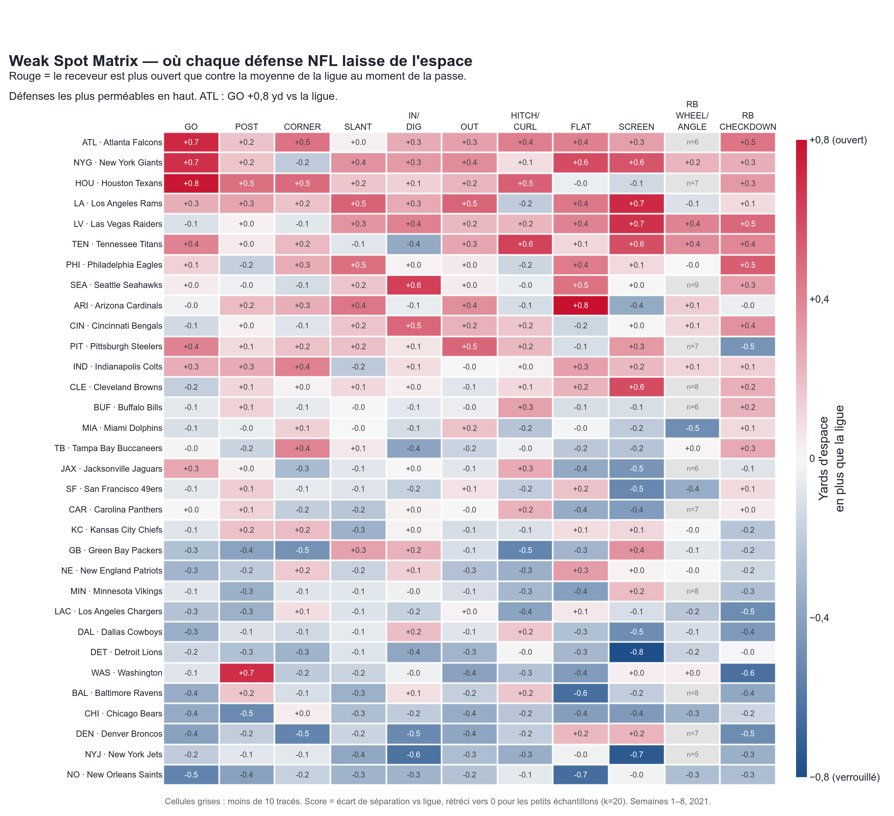
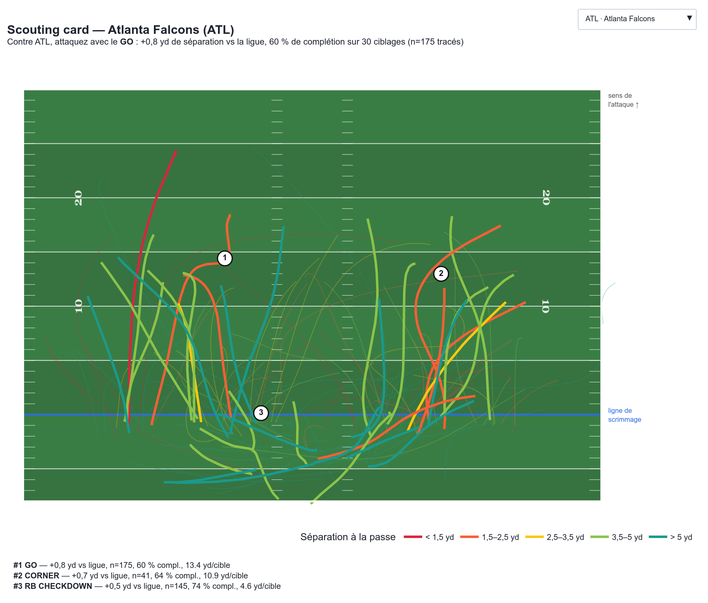
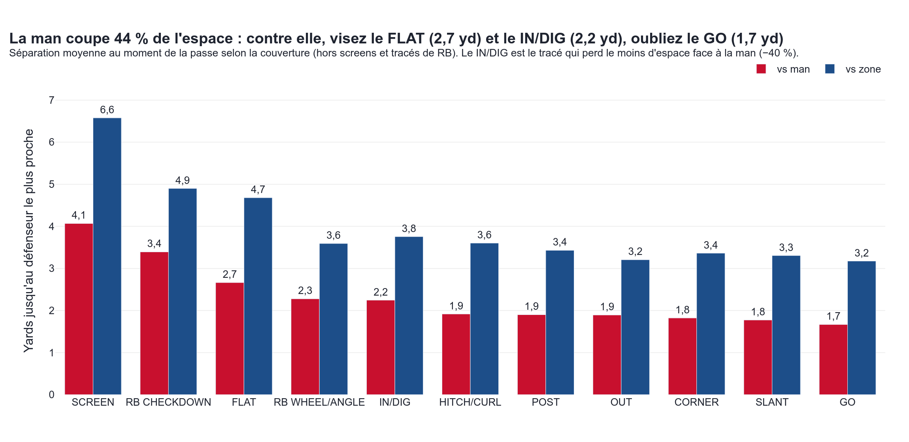
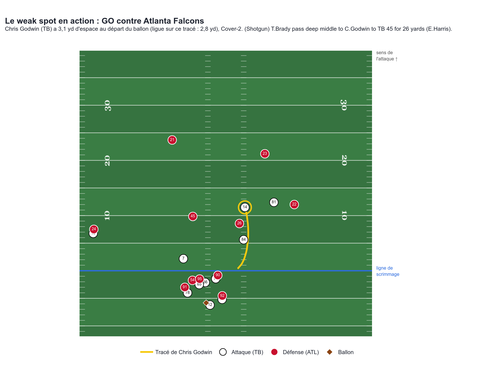

# Weak Spot : quels tracés courir contre chaque défense NFL ?

À partir du tracking Next Gen Stats (semaines 1 à 8 de 2021), nous classons automatiquement 35 032 tracés de WR, TE et RB en 11 familles (GO, POST, SLANT, OUT, etc.). Pour chacun, nous mesurons la **séparation au moment où le ballon part**, c'est-à-dire la distance au défenseur le plus proche. Comparée à la moyenne de la ligue, cette mesure révèle le point faible de chaque défense : contre **Houston, le GO laisse 3,7 yd d'espace contre 2,8 yd pour la ligue (+0,9 yd)**. Ce gain se retrouve sur le terrain avec **58 % de complétion (ligue : 44 %) et 16,1 yards par cible (ligue : 12,1)**. Atlanta est la défense la plus perméable dans l'ensemble, New Orleans la plus hermétique. La couverture compte aussi : face à la man, la séparation chute de 44 % en moyenne. Contre elle, les tracés courts (FLAT, puis IN/DIG) restent les plus ouverts, alors que le GO est étouffé (1,7 yd).

**Visualisation interactive** : téléchargez et ouvrez [`weak_spot.html`](weak_spot.html), un fichier autonome qui ne demande pas de serveur. Il contient la heatmap avec un survol détaillé, une scouting card avec un menu déroulant pour les 32 défenses, et la comparaison Man vs Zone.







Le weak spot en action : Chris Godwin sur un GO contre ATL (Cover-2), avec 3,1 yd d'espace au moment de la passe, pour un gain de 26 yards. Le HTML contient la version animée.



## Comment lancer

```bash
pip install -r requirements.txt
./run_all.sh   # clone les données si besoin, puis dataset → classification → métriques → visuels (~2 min)
```

## Méthode

1. `src/build_dataset.py` : ne garde que les frames entre le snap et la passe, oriente toujours l'attaque vers la droite et exprime chaque tracé par rapport à la position du joueur au snap (latéral + = vers la ligne de touche). Calcule aussi la distance au défenseur le plus proche à la frame de la passe, et retrouve le receveur ciblé dans `playDescription`.
2. `src/classify_routes.py` : règles géométriques lisibles (profondeur à la passe, cap sur les 0,6 dernières secondes, profondeur de la cassure, retour vers le QB). Les cas ambigus vont dans `OTHER` (18 %). Le contrôle visuel est dans [`figures/route_tree_check.png`](figures/route_tree_check.png).
3. `src/metrics.py` : vulnérabilité = séparation de la défense moins séparation de la ligue sur ce tracé, avec un shrinkage bayésien empirique `Δ·n/(n+20)`. Les cellules où n < 10 sont masquées.
4. `src/visualize.py` : produit le HTML Plotly et les PNG.

## Limites

- Seulement 8 semaines de données (environ 1 100 tracés par défense) : certaines cellules restent bruitées malgré le shrinkage.
- La séparation est mesurée **au moment de la passe**, pas à la réception (le tracking s'arrête peu après). Elle ne tient pas compte de la position du défenseur (devant ou derrière le receveur).
- La classification par règles reste approximative : les tracés interrompus par une passe rapide finissent dans `OTHER`, et les combinaisons ou les option routes ne sont pas distinguées.
- Ce sont des associations, pas des effets causaux : le contexte (down, distance, qualité du QB adverse) n'est pas contrôlé.
